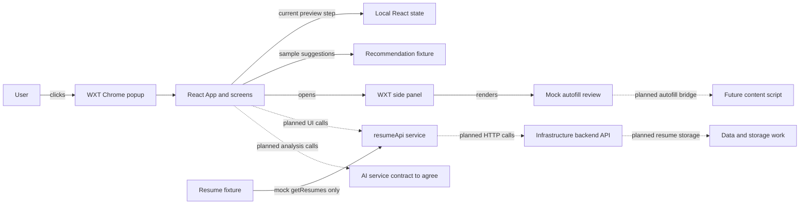

# Matchob frontend developer guide

This guide describes the frontend **as it exists in this repository**. Matchob is intended to help people tailor resumes to job applications. Today, its Chrome extension has a popup that previews the planned flow and a side panel for a mock autofill review. It does not upload resumes, analyze jobs, fill real forms, or call the backend. Start in [`frontend/`](frontend/).

## 1. What runs today

- **WXT** builds and runs the browser extension. It discovers the popup and side panel entrypoints and creates a Chrome Manifest V3 extension.
- **React** renders both entrypoints from small components and a shared `AppLayout`. The popup's `App` keeps the current preview step in local component state.
- **TypeScript** checks component props and shared data shapes, including `Resume` and `Recommendation`.
- **Styling is plain CSS** in [`frontend/entrypoints/popup/style.css`](frontend/entrypoints/popup/style.css) and [`frontend/entrypoints/sidepanel/style.css`](frontend/entrypoints/sidepanel/style.css). The current package has **no Tailwind dependency or configuration**. Add Tailwind only after the team agrees to adopt it; there are no Tailwind classes to follow yet.

The eventual system would connect this UI to backend services for resume data and AI recommendations, and may add a content script for form filling. Those connections are **planned**. The current backend template declares a protected `GET /profile` route, but there is no frontend client for it and the template's referenced handler directory is absent in this checkout. Do not treat it as a working frontend integration.

## 2. Get started

### Prerequisites

Install Git, **Node.js 22 or newer**, npm, and Google Chrome. Node 22 is the minimum stated in [`frontend/README.md`](frontend/README.md) for the installed WXT version. You do not need the backend to preview the popup. The commands below are the repository's documented commands; `check` and `build` were also run successfully against this checkout.

From a terminal, clone the repository once:

```bash
git clone https://github.com/FSU-CloudClub/CloudClub-Fall2027-Matchob.git
cd CloudClub-Fall2027-Matchob
cd frontend
```

The last command puts you beside [`frontend/package.json`](frontend/package.json). Install the locked dependencies, then start the Chrome development runner:

```bash
npm install
npm run dev
```

`npm install` installs the dependencies and automatically runs the `postinstall` script (`wxt prepare`), which generates WXT support files. `npm run dev` runs `wxt -b chrome`; the project README says WXT opens Chrome with the extension loaded. Click or pin the **Matchob** extension icon to open its popup. On Windows PowerShell, use `npm.cmd` instead of `npm` if PowerShell blocks the npm script.

In the popup, click **Get Started**, then **Back** and **Next**. You should see the landing, Resume Vault, job description, supporting context, and recommendation review screens. Click **Open side panel** to see the mock autofill review. The recommendation screen shows two sample suggestions. The Vault upload button is disabled. This is a **UI smoke test**, not a test of uploads or AI.

For a manual unpacked-extension check or a production build, run:

```bash
npm run check
npm run build
```

`check` runs TypeScript without emitting files. `build` creates [`frontend/.output/chrome-mv3/`](frontend/.output/chrome-mv3/) locally. Open `chrome://extensions` in Chrome, enable **Developer mode**, choose **Load unpacked**, and select that `chrome-mv3` directory. Open the Matchob popup and repeat the navigation check. After another build, click **Reload** on its extension card before checking changes. `.output/`, `.wxt/`, and `node_modules/` are generated and ignored by Git. Chrome is the only browser targeted by the package scripts; no Safari setup or build is implemented here.

## 3. Find your way around

Paths below are relative to the repository root. The tree lists source and configuration; generated directories are omitted.

```text
frontend/
├── entrypoints/
│   ├── popup/
│   │   ├── index.html          # WXT-discovered popup page and root element
│   │   ├── main.tsx            # mounts React and imports CSS
│   │   ├── App.tsx             # preview screen order and navigation state
│   │   └── style.css           # shared and popup CSS
│   └── sidepanel/
│       ├── index.html          # WXT-discovered side panel page
│       ├── main.tsx            # mounts the autofill review in AppLayout
│       └── style.css           # side panel CSS
├── components/
│   ├── AppLayout.tsx           # shared popup/side panel shell
│   ├── Button.tsx              # shared primary/secondary button
│   └── ThemeToggle.tsx         # shared light/dark control
├── pages/
│   ├── LandingScreen.tsx
│   ├── JobDescriptionScreen.tsx
│   ├── SupportingContextScreen.tsx
│   ├── RecommendationReviewScreen.tsx
│   └── AutoFillReviewScreen.tsx
├── features/
│   └── resumes/
│       ├── ResumeVault.tsx
│       ├── ResumeUpload.tsx
│       ├── ResumeTagsRename.tsx
│       ├── ResumeDeleteDialog.tsx
│       └── ResumePreviewDownload.tsx
├── mocks/
│   ├── resumes.ts
│   ├── recommendations.ts
│   └── autofill.ts
├── services/
│   ├── resumeApi.ts
│   └── README.md
├── types/
│   └── index.ts
├── utils/
│   └── flow.ts
├── wxt.config.ts
├── tsconfig.json
├── package.json
├── package-lock.json
├── .gitignore
└── README.md
```

| Area | Purpose and when to edit it | Likely collaborators |
| --- | --- | --- |
| [`entrypoints/popup/`](frontend/entrypoints/popup/) | WXT's popup entrypoint. Edit `App.tsx` for popup navigation, `main.tsx` for mounting, and `style.css` for shared and popup styles. Coordinate changes to the shared flow. | Frontend |
| [`entrypoints/sidepanel/`](frontend/entrypoints/sidepanel/) | WXT's side panel entrypoint. `main.tsx` renders the mock autofill review; `style.css` adjusts the panel layout. | Frontend, Autofill |
| [`components/`](frontend/components/) | Reusable React UI: `AppLayout`, `Button`, and `ThemeToggle`. Add broadly shared controls here. | Frontend |
| [`pages/`](frontend/pages/) | Workflow screens. Most are explanatory placeholders; recommendation review reads a fixture. Edit when building those views. | Frontend, AI for review UI |
| [`features/resumes/`](frontend/features/resumes/) | Resume-specific UI. Only Vault and its disabled upload button render now; rename, delete, and preview components return `null`. Edit as each resume task is implemented. | Frontend, Data |
| [`mocks/`](frontend/mocks/) | Typed sample resume metadata and recommendation suggestions. Use to develop views without a server; these are not persisted. | Frontend, AI, Data |
| [`services/`](frontend/services/) | Frontend API boundary. `resumeApi.ts` has a mocked read and explicit mutation stubs. Replace or extend service methods when an API contract is agreed. | Frontend, Data, Infrastructure |
| [`types/`](frontend/types/) | Shared TypeScript shapes. Update with frontend and backend owners when payloads change. | All teams |
| [`utils/`](frontend/utils/) | `flow.ts` holds the labels for the six preview steps. Update it with `App.tsx` when changing the preview order. | Frontend |
| Configuration | [`wxt.config.ts`](frontend/wxt.config.ts) enables React and sets manifest name/description. [`tsconfig.json`](frontend/tsconfig.json) enables strict checking and React JSX. [`package.json`](frontend/package.json) has scripts and dependencies; the lockfile pins installs. | Frontend, Infrastructure |

There is **no hooks directory, API base URL configuration, environment file, static assets directory, background script, or content script** in the frontend. Create one only when the corresponding feature needs it and its owner agrees on the contract. The popup CSS supplies shared styles, and the side panel CSS adds its layout rules; there is no Tailwind setup to modify.

## 4. How the pieces interact

[`frontend/entrypoints/popup/index.html`](frontend/entrypoints/popup/index.html) provides `<div id="root">`. [`main.tsx`](frontend/entrypoints/popup/main.tsx) mounts React's `App` there and imports the CSS. [`App.tsx`](frontend/entrypoints/popup/App.tsx) stores an integer `step` with `useState`. Button clicks change that integer; `App` picks a screen and label from its `popupPages` array. The labels come from [`flow.ts`](frontend/utils/flow.ts). The final popup button opens the separate side panel, which renders `AutoFillReviewScreen` inside the same [`AppLayout`](frontend/components/AppLayout.tsx). Popup step state lasts only while the popup is open. No router, global store, browser storage, or network request participates in navigation.

The recommendation screen directly maps [`mockRecommendations`](frontend/mocks/recommendations.ts) to list items. The resume fixture is read by [`resumeApi.getResumes()`](frontend/services/resumeApi.ts), but the current Vault screen does **not** call that method, so the sample resume is not displayed. The type definitions in [`types/index.ts`](frontend/types/index.ts) check code at development time; they do not validate server responses at runtime.



Solid arrows describe existing behavior. Dashed arrows describe work that has **not** been connected. [`backend/SAMproject/template.yaml`](backend/SAMproject/template.yaml) configures a Cognito-protected API and declares `GET /profile`; it does not define resume or AI routes in this checkout. [`frontend/services/README.md`](frontend/services/README.md) lists *possible* resume endpoints, each marked “or equivalent.” Those are proposals, not deployed or agreed endpoint definitions.

## 5. Integration points for other teams

### AI team

The analysis request path and response handler **do not exist yet**. The proposed UI path is: job description and supporting context screens collect input; a new service function sends the agreed request; the recommendation review screen renders its response. Agree with Frontend on request fields, response fields, loading/error behavior, and when analysis is triggered before implementing that path. [`JobDescription`](frontend/types/index.ts), `Recommendation`, and the sample recommendations are the current starting shapes. The sample `reason` field exists but the current review screen displays only `suggestion`.

To replace the visible fixture, have the review flow call an agreed AI service, store its response in React state, and pass the returned recommendations to [`RecommendationReviewScreen.tsx`](frontend/pages/RecommendationReviewScreen.tsx) instead of importing the fixture there. Keep the fixture available for isolated UI development. Inspect these files first:

| Team | Relevant files | Integration responsibility | Current status |
| --- | --- | --- | --- |
| AI | [`pages/JobDescriptionScreen.tsx`](frontend/pages/JobDescriptionScreen.tsx), [`pages/SupportingContextScreen.tsx`](frontend/pages/SupportingContextScreen.tsx), [`pages/RecommendationReviewScreen.tsx`](frontend/pages/RecommendationReviewScreen.tsx), [`mocks/recommendations.ts`](frontend/mocks/recommendations.ts), [`types/index.ts`](frontend/types/index.ts) | Agree on analysis request/response types and add a service boundary with Frontend; connect request states to the screens. | Input screens are placeholders; recommendation display uses a local fixture; no AI call or parsing service. |

### Data team

[`Resume`](frontend/types/index.ts) currently contains `id`, `name`, `tags`, and `uploadedAt`. [`resumeApi.ts`](frontend/services/resumeApi.ts) defines `getResumes`, `getUploadUrl`, `renameResume`, `updateTags`, `deleteResume`, and `getDownloadUrl`. Only `getResumes()` returns data, and it returns a copy of [`mocks/resumes.ts`](frontend/mocks/resumes.ts). Every other method throws a “not implemented” error. The Vault does not yet use the mock list.

The intended flow is for the Vault to load a list through the service and update its displayed state after successful operations. Upload needs a file picker, an agreed request for a short-lived upload URL, a browser upload to that URL, and a backend confirmation or refresh step if the contract requires one. [`UploadUrlResponse`](frontend/types/index.ts) currently has only `resumeId` and `uploadUrl`; method, headers, expiry, confirmation, file limits, and errors are unspecified. Rename and tags should update the visible item after a successful service response; delete should remove it after confirmation and success; download should use an authorized URL returned by the service. Preview is still undefined. Keep storage access and AWS credentials out of React components.

The backend's [`boto3-services.md`](backend/SAMproject/docs/boto3-services.md) illustrates a presigned S3 URL, **not a completed endpoint**. It also notes that its local `http://s3:9090` hostname resolves only inside containers, so browser testing needs a reachable URL and CORS arrangement agreed with Infrastructure.

| Team | Relevant files | Integration responsibility | Current status |
| --- | --- | --- | --- |
| Data | [`features/resumes/`](frontend/features/resumes/), [`services/resumeApi.ts`](frontend/services/resumeApi.ts), [`types/index.ts`](frontend/types/index.ts), [`mocks/resumes.ts`](frontend/mocks/resumes.ts) | Agree on resume metadata and upload/download contracts; implement the service and connect list, mutation, and request states with Frontend. | One mocked list method; upload, rename, tags, delete, download, and preview are unimplemented. |

### Infrastructure and backend team

There is currently **no frontend API base URL or environment variable**. Add configuration in the frontend when a deployed or local API origin is agreed, and have service functions use it. Do not hard-code a developer's URL or put secrets in extension bundles. The package's build does not grant API host permissions; check the generated manifest and agree on permissions before introducing cross-origin calls. The backend template applies a Cognito authorizer to its declared API, while [`docs/auth.md`](backend/SAMproject/docs/auth.md) describes bearer tokens in production and a local-only `X-Local-User` header under SAM. The extension has no login/token flow. A browser extension needs its own agreed auth callback/token storage design; the backend template's `localhost:3000` callback does not establish one.

Define endpoint URLs, HTTP methods, request/response models, authentication, CORS (API and S3 upload origin), and error shapes with the owning teams. Put network and response handling in services, then connect components to those services. The only concrete route declared in [`template.yaml`](backend/SAMproject/template.yaml) is `GET /profile`; the file points to a handler directory absent from this checkout, so check backend readiness before relying on it. The resume endpoint examples in [`frontend/services/README.md`](frontend/services/README.md) are suggestions only. There are no deployed AI, resume, upload, or autofill endpoint contracts in the frontend.

| Team | Relevant files | Integration responsibility | Current status |
| --- | --- | --- | --- |
| Infrastructure / Backend | [`frontend/wxt.config.ts`](frontend/wxt.config.ts), [`frontend/services/resumeApi.ts`](frontend/services/resumeApi.ts), [`frontend/services/README.md`](frontend/services/README.md), [`backend/SAMproject/template.yaml`](backend/SAMproject/template.yaml), [`backend/SAMproject/docs/auth.md`](backend/SAMproject/docs/auth.md) | Agree on API origins, permissions, auth, CORS, endpoint contracts, and errors; replace service stubs with calls after routes are ready. | No frontend environment setup or HTTP calls; backend template declares a protected profile route but no resume/AI routes. |

## 6. Make a frontend change

1. **Add a component:** Follow [`Button.tsx`](frontend/components/Button.tsx): export a named function, type its props, and put shared UI in `components/`. Use [`AppLayout.tsx`](frontend/components/AppLayout.tsx) for the existing popup or side panel shell. Put resume-specific UI in `features/resumes/`.
2. **Add or change a view:** Edit a file in [`pages/`](frontend/pages/) or the resume feature folder. For the current popup flow, register a new view in the `popupPages` array in [`App.tsx`](frontend/entrypoints/popup/App.tsx) and a matching label in [`flow.ts`](frontend/utils/flow.ts). Keep their order aligned.
3. **Style it:** Add semantic class names and CSS rules to [`style.css`](frontend/entrypoints/popup/style.css), following `.screen`, `.button`, and `.navigation`. Tailwind utilities are not supported by this setup.
4. **Shape data:** Add or update a type in [`types/index.ts`](frontend/types/index.ts) after agreeing on the payload. Use `import type` as the mocks and service do. Types are compile-time checks, so validate untrusted server data where it enters a future service.
5. **Add a service method:** Extend the interface and implementation in [`resumeApi.ts`](frontend/services/resumeApi.ts), or add a service file under the existing `services/` folder for a distinct agreed API. Keep endpoint URLs, auth headers, response parsing, and useful errors there.
6. **Connect UI to a service:** Let the view manage loading, success, and error state, then render the result. The example below is **illustrative code, not an existing component**. It uses the existing mocked `getResumes()` method, so it does not prove network integration.

```tsx
import { useEffect, useState } from 'react';
import { resumeApi } from '../services/resumeApi';
import type { Resume } from '../types';

export function ExampleResumeList() {
  const [items, setItems] = useState<Resume[]>([]);
  const [loading, setLoading] = useState(true);
  const [error, setError] = useState<string | null>(null);

  useEffect(() => {
    let active = true;
    resumeApi.getResumes()
      .then((result) => { if (active) setItems(result); })
      .catch(() => { if (active) setError('Could not load resumes.'); })
      .finally(() => { if (active) setLoading(false); });
    return () => { active = false; };
  }, []);

  if (loading) return <p>Loading resumes…</p>;
  if (error) return <p role="alert">{error}</p>;
  return <ul>{items.map((item) => <li key={item.id}>{item.name}</li>)}</ul>;
}
```

For mock work, edit the typed fixtures in [`mocks/`](frontend/mocks/) and label sample content in the UI. The current recommendation screen directly imports its fixture; the current resume service copies its fixture. Mutations deliberately throw, so handle their errors if you wire a placeholder button before the real API is ready. Do not present a successful upload, rename, or delete based only on local mock data.

## 7. Commands at a glance

Run these from `frontend/` unless stated otherwise. The script names and bodies are in [`package.json`](frontend/package.json).

| Command | What it does | When to use it |
| --- | --- | --- |
| `npm install` | Installs dependencies; automatically runs `postinstall` (`wxt prepare`). | After cloning or when dependencies change. |
| `npm run dev` | Runs `wxt -b chrome`, the Chrome development runner. | While editing and previewing the popup. |
| `npm run check` | Runs `tsc --noEmit`. **Verified passing in this checkout.** | Before a pull request. |
| `npm run build` | Runs `wxt build -b chrome`. **Verified passing in this checkout.** | To validate and load the production bundle. |
| `npm run postinstall` | Runs `wxt prepare`; normally called by `npm install`. | If WXT's generated setup needs refreshing. |

There is no `test`, `lint`, Tailwind, Safari, or Firefox script in this package. `npm run dev` is verified from the package script and frontend README; this guide's validation did not include an interactive Chrome session.

## 8. GitHub workflow

The root [`README.md`](README.md) sets the team rules: one branch per task, one focused pull request, and no direct push to `main`. Link the relevant GitHub issue and Notion task in the PR. Coordinate with the Frontend Lead before changing shared architecture or API contracts.

From the repository root, sync and create a branch for your issue:

```bash
git checkout main
git pull origin main
git checkout -b your-name/issue-short-title
```

Make focused edits, run the frontend checks above, then review and publish your work:

```bash
git status
git diff
git add FRONTEND_GUIDE.md
git commit -m "Document frontend development workflow"
git push -u origin your-name/issue-short-title
```

The `git add` line is an **example for this guide**; stage the actual files you changed for another task. On GitHub, open a PR targeting `main`, describe what changed and how you tested it, link the issue and Notion task, and request review. The root README also documents optional `gh pr create --base main --fill` for users who have GitHub CLI installed.

If your branch conflicts with newer `main`, fetch it and merge it into your feature branch:

```bash
git fetch origin
git merge origin/main
git status
```

Git marks conflicted files. Edit them to keep the intended combined result, remove conflict markers, then `git add` those files and `git commit`. Re-run `npm run check` and `npm run build` after resolving frontend conflicts. Ask the other owner before choosing between competing shared-contract changes. If pushing is denied, check that you are on your own branch and that your GitHub account has access; use the team's fork workflow if required.

## 9. Troubleshooting

| Symptom | What to check |
| --- | --- |
| Install fails | **Project-specific:** use Node 22+ and run `npm install` inside `frontend/`; `postinstall` prepares WXT. **General:** inspect npm's error and network/registry access; try a fresh install after resolving it. |
| Development runner does not start | **Project-specific:** confirm you are in `frontend/`, Chrome is installed, and `npm run dev` is the script. On PowerShell, use `npm.cmd` if the npm script is blocked. **General:** inspect terminal output and port/process conflicts. |
| Extension is missing in Chrome | **Project-specific:** for manual loading, select `frontend/.output/chrome-mv3/` after `npm run build`, not the source folder; enable Developer mode in `chrome://extensions`. For the dev runner, check its terminal output. |
| Changes do not appear | **Project-specific:** rebuild, click **Reload** on the Matchob extension card, then reopen the popup. The development runner may need the popup reopened. |
| TypeScript errors | **Project-specific:** run `npm run check`; `tsconfig.json` uses strict checking and depends on generated `.wxt/` configuration. Run `npm install` if that generated configuration is missing. **General:** inspect the reported file and type rather than disabling checks. |
| Missing environment variables | **Project-specific:** the frontend has no required `.env` file or API URL today. If new code expects one, agree on its name and setup with Infrastructure and document it. Backend environment files are a separate setup. |
| API calls fail | **Project-specific:** this frontend currently makes no API calls. `resumeApi` mutations intentionally reject, and `getResumes()` is local. For new calls, check the agreed URL, running backend, request/response contract, auth, and browser console/Network tab. |
| CORS error | **Project-specific:** no browser-to-backend or browser-to-S3 path has been configured. Coordinate the extension origin/host permissions and server or S3 CORS policy with Infrastructure. **General:** read the failing request and response in DevTools; changing only frontend headers cannot grant server permission. |
| Git branch or push error | **Project-specific:** work on a feature branch and open a PR to `main`. **General:** run `git status`, check remote access, and confirm you have push permission or need a fork. |

## 10. Start here: AI, Data & Infrastructure teams

You can scan this section in a few minutes, then follow the linked files into your workstream.

- [ ] Clone the repository, `cd frontend`, run `npm install` and `npm run dev`; open the Matchob popup in Chrome.
- [ ] Read [`App.tsx`](frontend/entrypoints/popup/App.tsx) and [`types/index.ts`](frontend/types/index.ts) to understand navigation and shared shapes.
- [ ] **AI:** inspect the input/review screens and [`mocks/recommendations.ts`](frontend/mocks/recommendations.ts); agree on an analysis contract before adding a service.
- [ ] **Data:** inspect [`features/resumes/`](frontend/features/resumes/) and [`resumeApi.ts`](frontend/services/resumeApi.ts); agree on list, upload, mutation, and download payloads before wiring UI.
- [ ] **Infrastructure:** inspect [`wxt.config.ts`](frontend/wxt.config.ts), [`services/README.md`](frontend/services/README.md), and [`backend/SAMproject/template.yaml`](backend/SAMproject/template.yaml); agree on API origin, permissions, auth, CORS, and error shape.
- [ ] Run `npm run check` and `npm run build`; load the built Chrome extension to smoke test the popup. Use backend tests separately for backend routes.
- [ ] Coordinate shared types, navigation, API contracts, and extension permissions with the Frontend Lead before changing them. Do not put secrets or AWS credentials in the frontend bundle.

### Decisions still needed

The teams need an agreed AI analysis request/response and trigger; resume list/upload/confirmation/download contracts, file limits, and error shapes; a browser-reachable upload URL for local testing; an extension-compatible Cognito login/token flow; API and S3 CORS plus extension host permissions; and whether Tailwind will actually be adopted. The backend's profile handler target also needs to be present and validated before anyone treats `GET /profile` as usable by the extension.
