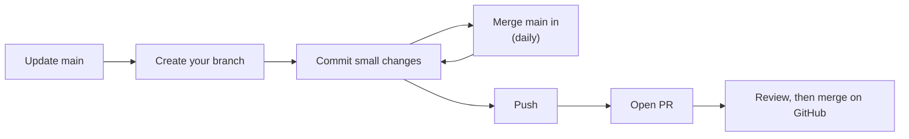

# Git Workflow

**Purpose:** How we use Git and GitHub, and a reference for the commands you'll need.
**Tech:** Git, GitHub pull requests.
**Role in the project:** Everyone follows the same steps, so merges are small and conflicts are rare and easy to fix.

## The workflow



```bash
# 1. Start from an up-to-date main
git switch main
git pull

# 2. Create a branch for one task (never commit directly to main)
git switch -c <name>-<task>          # e.g. sarah/upload-url

# 3. Commit as you go (small commits are easier to review and to undo)
git status                           # what changed
git diff                             # the changes themselves
git add <file> <file>                # stage specific files (avoid `git add .` until you've checked git status)
git commit -m "Add presign_upload helper"

# 4. Bring in other people's work at least once a day
git fetch
git merge origin/main                # merges GitHub's latest main into your branch; fix conflicts now while they're small

# 5. Push
git push -u origin <name>-<task>     # first push: creates the branch on GitHub
git push                             # every push after that

# 6. Open a pull request on GitHub
#    - Base: main. Compare: your branch.
#    - Say what changed and how you tested it (the "Done when" checks from your endpoint doc).
#    - Merge origin/main in once more right before asking for review.

# 7. After it's merged
git switch main
git pull
git branch -d <name>-<task>          # delete your local copy of the branch
```

## How we avoid conflicts

A conflict happens when two branches change the same lines. Most of ours can be avoided:

- **Stay in your own files.** Each endpoint has its own doc and its own function. Don't reformat, rename or "tidy up" code you aren't assigned to.
- **Shared files: add, don't rewrite.** In files several people touch (`resume_helpers.py`, `matchob_common/validators.py`, `env.example.json`, templates), add your new code at the **end** of the relevant section and don't move existing lines. Two people adding to different places merge cleanly.
- **Merge `origin/main` daily.** A one-day-old conflict is three lines; a one-week-old conflict is a rewrite.
- **Keep PRs small and merge them fast.** A PR that sits open for days collects conflicts.
- **Say it in the group chat** before you change anything shared, such as a template, a shared helper's signature or the contract.

## Command reference

### Seeing what's going on
| Command | What it does |
|---|---|
| `git status` | Current branch, changed files, and whether you're mid-merge |
| `git diff` | Unstaged changes. `git diff --staged` for staged ones |
| `git log --oneline -10` | Last 10 commits |
| `git log --oneline main..HEAD` | Commits on your branch that aren't on `main` |
| `git branch -a` | All local and remote branches |
| `git fetch` | Download GitHub's latest without changing your files |

### Branches
| Command | What it does |
|---|---|
| `git switch <branch>` | Move to a branch |
| `git switch -c <branch>` | Create a branch from where you are and move to it |
| `git branch -d <branch>` | Delete a merged local branch |
| `git push -u origin <branch>` | Publish a new branch to GitHub |

### Saving work
| Command | What it does |
|---|---|
| `git add <file>` | Stage a file for the next commit |
| `git commit -m "..."` | Commit staged changes |
| `git commit --amend` | Change the last commit (only if not pushed yet) |
| `git stash` | Put uncommitted changes aside, e.g. to switch branches |
| `git stash pop` | Bring them back |

### Updating
| Command | What it does |
|---|---|
| `git pull` | Fetch and merge GitHub's version of your current branch |
| `git merge origin/main` | Merge the latest `main` into your branch (run `git fetch` first) |
| `git merge --abort` | Cancel a merge that has conflicts |

### Undoing
| Command | What it does |
|---|---|
| `git restore <file>` | Throw away uncommitted changes to a file. **Can't be undone** |
| `git restore --staged <file>` | Unstage a file, keeping the changes |
| `git revert <commit>` | Make a new commit that undoes an old one. Safe on pushed commits |
| `git reset --soft HEAD~1` | Undo the last commit but keep its changes staged (only if not pushed) |

Avoid `git reset --hard` and `git push --force` on shared branches. Both can permanently delete your work or your teammates'. Ask first.

## Common errors

| Message | Fix |
|---|---|
| `Your local changes would be overwritten by checkout` | Commit or `git stash` before switching branches |
| `untracked working tree files would be overwritten` | A file you haven't committed exists on the other branch. Move or delete your copy |
| `Merging is not possible because you have unmerged files` | You're still mid-merge. Resolve the conflicts, `git add` and `git commit`, or `git merge --abort` |
| `rejected ... (fetch first)` on push | GitHub has commits you don't. `git pull`, then push again |
| `zsh: command not found: code` | In VS Code: Cmd+Shift+P → "Shell Command: Install 'code' command in PATH" |

---

New to a term? See the [glossary](glossary.md).
