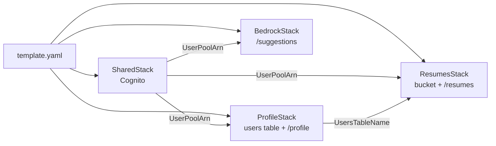

# Nested Stacks (Infrastructure as Code)

**Purpose:** How the SAM templates are organized, and how to add a route, a Lambda or a whole new service.
**Tech:** AWS SAM, CloudFormation nested stacks, YAML.
**Role in the project:** Each service has its own template, so people working on different services don't edit the same file.

## Layout

```
template.yaml                     root: only lists the stacks and passes values between them
templates/
├── shared-template.yaml          Cognito user pool, app client, hosted login domain
├── dynamodb-template.yaml        profile service: users table, profile API, ProfileFunction
├── s3-template.yaml              resumes service: upload bucket, resumes API, ResumesFunction
└── bedrock-template.yaml         AI service: BedrockApi, BedrockFunction
src/
├── shared/matchob_common/        shared layer code (see shared-helpers.md)
├── dynamodb-pipeline/            ProfileFunction code
├── s3-pipeline/                  ResumesFunction code
└── bedrock-pipeline/             BedrockFunction code
```



## How values move between stacks

A child template declares what it needs under `Parameters:` and what it shares under `Outputs:`. The root wires one stack's output into another's parameter with `!GetAtt <Stack>.Outputs.<Name>`:

```yaml
  ResumesStack:
    Type: AWS::Serverless::Application
    Properties:
      Location: templates/s3-template.yaml
      Parameters:
        UserPoolArn: !GetAtt SharedStack.Outputs.UserPoolArn
        UsersTableName: !GetAtt ProfileStack.Outputs.UsersTableName
```

The root's own `Parameters:` are only for values that come from outside CloudFormation: the Bedrock console's `PromptArn`, `GuardrailId` and `GuardrailVersion`. They're set with `parameter_overrides` in `samconfig.toml` and passed to `BedrockStack` with `!Ref`.

## Rules that aren't obvious

- **Paths in a child template are relative to that template.** Use `CodeUri: ../src/<pipeline>/`, not `src/<pipeline>/`.
- **`Globals` don't cross stacks.** Each child template has its own `Globals` block for runtime, timeout, layer and shared environment variables.
- **Each stack defines its own `SharedLayer`.** `sam local` can't use a layer passed in from another stack, so every child template has the same 8-line `SharedLayer` block pointing at `../src/shared`. Copy it as-is.
- **An `Api` event must use an API in the same template.** That's why each service has its own API Gateway and its own base URL.
- **An API with no routes fails to deploy.** Don't add an `AWS::Serverless::Api` until it has at least one `Events` entry.
- **Locally, `env.json` overrides environment variables.** Values that come from another stack (like `USERS_TABLE`) or from a resource (like `UPLOAD_BUCKET`) aren't resolved by `sam local`, so `env.json` sets them for every function.
- **Moving a resource to another stack recreates it.** CloudFormation deletes it from the old stack and creates a new one. For a table, bucket or user pool, that loses the data.

## Add a route to an existing Lambda

1. Add an entry under the function's `Events:` in its template. The event name must be unique within the function.
   ```yaml
        UpdateResume:
          Type: Api
          Properties:
            RestApiId: !Ref ResumesApi
            Path: /resumes/{resumeId}
            Method: patch
   ```
2. Add the matching `@app.<method>("<path>")` function in `src/<pipeline>/app.py`. Path parameters use `{name}` in the template and `<name>` in Powertools.
3. If the route needs an AWS permission the function doesn't have, add it under `Policies:` (see the cheat sheet below).

## Add a Lambda to an existing stack

```yaml
  NewFunction:                                  # logical ID: PascalCase + "Function"
    Type: AWS::Serverless::Function
    Properties:
      CodeUri: ../src/<folder>/                 # app.py + requirements.txt
      Handler: app.lambda_handler
      Environment:
        Variables:
          POWERTOOLS_SERVICE_NAME: <name>       # shown in every log line
      Policies:
        - DynamoDBReadPolicy:
            TableName: !Ref UsersTableName
      Events:
        SomeRoute:
          Type: Api
          Properties:
            RestApiId: !Ref <TheStackApi>
            Path: /something
            Method: get
```

`Runtime`, `Timeout`, `Layers` and the shared environment variables come from the template's `Globals`.

## Add a new service stack

1. Copy `templates/s3-template.yaml` to `templates/<service>-template.yaml`. Keep `SharedLayer` and the API with its Cognito authorizer. Replace the bucket, function and routes.
2. Declare the `Parameters:` it needs (usually `UserPoolArn`, and `UsersTableName` if it reads profiles). Add `Outputs:` for anything another stack or the frontend needs, such as `ApiUrl`.
3. Add it to the root `template.yaml` under `Resources:`, and its `ApiUrl` under the root `Outputs:`.
4. Create `src/<service>-pipeline/` with `app.py` and `requirements.txt`.
5. Add any new environment variable to the template's `Globals` and to both `env.json` and `env.example.json`.
6. Add the pipeline folder to `pythonpath` in `pytest.ini`.
7. Create `docs/<service>-pipeline/` with a `README.md`, a `helpers.md` and an `endpoints/` folder.

## Policy cheat sheet

```yaml
      Policies:
        - DynamoDBReadPolicy:                   # get / query / scan
            TableName: !Ref UsersTableName
        - DynamoDBCrudPolicy:                   # read + write
            TableName: !Ref UsersTableName
        - S3ReadPolicy:                         # get objects
            BucketName: !Ref UploadBucket
        - S3CrudPolicy:                         # get + put + delete objects
            BucketName: !Ref UploadBucket
        - Statement:                            # raw IAM (Bedrock has no SAM shortcut)
            - Effect: Allow
              Action: bedrock:InvokeModel
              Resource: "*"                     # narrow to the model ARN once one is chosen
```

Give each function only the permissions it uses. Raise `Timeout` (up to 29 seconds, API Gateway's limit) for slow calls like Bedrock.

## Check your change

```bash
sam validate --lint -t templates/<file>.yaml    # each template you changed
sam validate --lint                             # the root
sam build
python dev.py                                   # look for your route in the "Mounting ..." lines
```

Then test it as in [testing.md](testing.md).

---

New to a term? See the [glossary](glossary.md).
