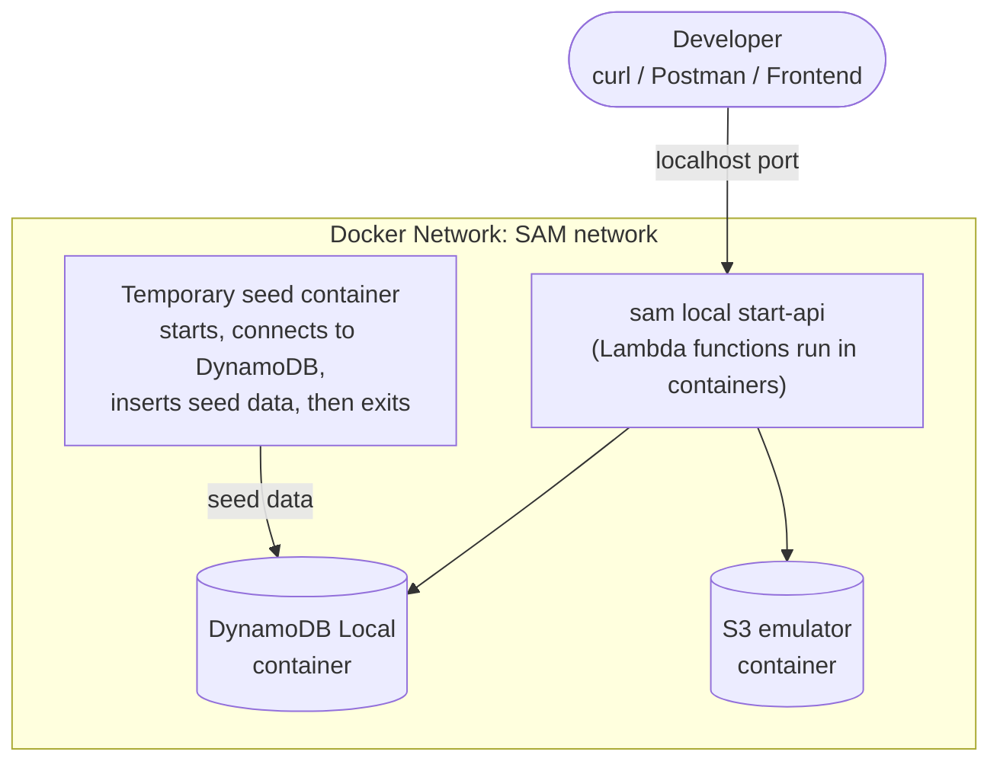

# Meeting Notes
This document will hold the notes from each of our meetings.

## Meeting 1
*Date: 10/13/2026*
### Agenda
1. Review (see below)
2. Code and Docs Tour (look through repo)
3. Attempted to set up local env (run `dev.py`)
### Architecture Review 
- Lambda: serverless compute
- DynamoDB: metadata
- S3: resumes
- Bedrock: AI access

### SAM Framework
- handle local testing
- handle deployment 
- Libraries: `boto3` (for accessing resources/services), `lambdaPowertools` (organize lambda functions)

### Local Dev Environment 
- SAM will set up a backend "server" to simulate lambdas
- Docker for local testing
- Docker container for DynamoDB and S3 (Bedrock is AI and can not be simulated)
- Everything runs in docker containers

*P.S. I made a file called dev.py and it sets up the local environment and runs one test. Run the python file and the docker containers + sam lambda simulation should be running. - Carter*

## Meeting 2
**Date: 10/15/2026**
### Endpoint Assignment
- Creating a user (post) - Tommy
- Editing a user (put) - Cooper
- Deleting a user - Santiago 
- Getting a user core metadata - Schneider
- Get user profile (get) - Carter

### HTTP Request Types
- Get: to get data
- Put: to place new rows
- Delete: to delete rows
- Patch: partial update 
- Put: full update
## Meeting 3
**Date: 10/22/2026**

> **PRs are due this Sunday, 10/25/2026,** against `main`.

### Backend refactor (Carter)
- **Nested stacks:** one template per service in `templates/`. See [nested-stacks.md](general/nested-stacks.md).
- **API contracts:** every profile and resume endpoint in [api-contracts.md](general/api-contracts.md).
- **Profile endpoints:** all four `/profile` routes rebuilt for the new fields.
- **Shared helpers:** parsing, JSON and validation in `matchob_common`. See [shared-helpers.md](general/shared-helpers.md).
- **Resumes setup:** S3 bucket, all 5 routes and every helper in [helpers.md](s3-pipeline/helpers.md) are ready.
- **Local dev:** new seed user, `S3_ENDPOINT` / `S3_PUBLIC_ENDPOINT` in `env.example.json`, old test files removed.
- **Docs:** `general/` plus one folder per pipeline, with a doc for every endpoint.

### Assignments
Each person owns every task in their rows. Fill in names:

| Person | Name |
|---|---|
| Person 1 | Tommy |
| Person 2 | Nate |
| Person 3 | Cooper |
| Person 4 | Schneider |
| Person 5 | Santiago |

### Tasks

| # | Task | Person | Depends on | Doc |
|---|---|---|---|---|
| 1 | `POST /resumes/upload-url` | Person 1 | | [create-upload-url.md](s3-pipeline/endpoints/create-upload-url.md) |
| 2 | `GET /resumes` | Person 2 | 1 | [list-resumes.md](s3-pipeline/endpoints/list-resumes.md) |
| 3 | `GET /resumes/{resumeId}/download-url` | Person 3 | 1 | [create-download-url.md](s3-pipeline/endpoints/create-download-url.md) |
| 4 | `PATCH /resumes/{resumeId}` | Person 4 | 1 | [update-resume.md](s3-pipeline/endpoints/update-resume.md) |
| 5 | `DELETE /resumes/{resumeId}` | Person 5 | 1 | [delete-resume.md](s3-pipeline/endpoints/delete-resume.md) |
| 6 | Rewrite `tests/unit/test_create_user.py` for the new profile fields | Person 2 | | [post-profile.md](dynamodb-pipeline/endpoints/post-profile.md) |
| 7 | Add unit tests for `GET`, `PUT` and `DELETE /profile` | Person 3 | | [dynamodb-pipeline/README.md](dynamodb-pipeline/README.md) and each endpoint doc |
| 8 | Propose how `DELETE /profile` cleans up resume files in S3, for the team to decide | Person 1 | | [delete-profile.md → Gap](dynamodb-pipeline/endpoints/delete-profile.md#gap-resume-files-are-left-in-s3) |

**"Depends on"** lists task numbers. Tasks 2–5 need a resume to exist, which task 1 creates. **Task 1 has to be done tonight, so assign it to someone that can fit that requirement.

### Git workflow
We work in small branches (**1 Per Task!**) that each get merged quickly, so conflicts stay rare and small. Full steps and commands: [git-workflow.md](general/git-workflow.md).

1. **Update `main`:** `git switch main` then `git pull`.
2. **Branch for one task:** `git switch -c <name>/<task>`. Never commit to `main`.
3. **Commit small working steps** as you go.
4. **Merge in everyone else's work** with `git fetch` then `git merge origin/main`, and fix any conflicts right away.
5. **Push** and **open a PR** against `main`, saying what changed and how you tested it.
6. **After it's merged,** switch back to `main`, pull, and branch for your next task.

Stay in your own files, add to the end of shared files instead of rewriting them, and post in the group chat before changing anything shared (a helper's signature, a template or the contract).

### Before opening your PR
- `sam validate --lint` and `sam build` pass.
- Every "Done when" check in your endpoint doc passes against `python dev.py`.

### Next steps
1. **Pull `main`** (`git switch main`, `git pull`) and **create a branch for your first task.**
2. **At the start of every dev session,** pull and merge in the latest `main` (`git fetch`, `git merge origin/main`) before writing any code.
3. **Aim to finish at least one task every session,** so every session ends with one PR opened.

## Meeting 4
**Date: 10/27/2026**

### Changes since Meeting 3 (Carter)
- **`defaultResume` is removed** from the [API contract](general/api-contracts.md#profile). The frontend now sends the resume to use with each request, so the profile doesn't need a default. The code and the other docs still have it; tasks 3–4 below remove it.
- **New endpoint `POST /suggestions`** in the [API contract](general/api-contracts.md#suggestions). The frontend parses the chosen resume into text and sends it with the job description. The backend calls a prompt that the AI team sets up in the Bedrock console (model, system prompt, output format, guardrail) and returns its JSON unchanged. It's synchronous, and nothing is saved.
- **Bedrock pipeline is set up.** Docs: [bedrock-pipeline/README.md](bedrock-pipeline/README.md). Every setup task is done:
  - `bedrock_helpers.py` with all helpers, tested by `tests/unit/test_bedrock_helpers.py` (23 passing).
  - `app.py` is cleaned up: no DynamoDB, and it imports everything the route needs.
  - `templates/bedrock-template.yaml` has the API, the `POST /suggestions` route, Bedrock permissions and a 28 s timeout.
  - The root `template.yaml` has 3 new parameters for the console IDs. See [nested-stacks.md](general/nested-stacks.md#how-values-move-between-stacks).
  - `samconfig.toml` and `env.example.json` have placeholders for the IDs.
- **Heads-up:** `tests/unit/test_create_user.py` still has 19 failing tests, because it tests the old profile fields. That's Meeting 3 task 6, still open.

### Tasks

| # | Task | Person | Depends on | Doc |
|---|---|---|---|---|
| 1 | `POST /suggestions`: write `create_suggestions()` in `src/bedrock-pipeline/app.py` and `tests/unit/test_create_suggestions.py` | | | [create-suggestions.md](bedrock-pipeline/endpoints/create-suggestions.md) |
| 2 | Get the prompt version ARN, guardrail ID and guardrail version from the AI team. Send them the variable names and output format they must match. Fill in `parameter_overrides` in `samconfig.toml`, deploy, and run the smoke test | | 1 | [bedrock-pipeline/README.md → What we own](bedrock-pipeline/README.md#what-we-own-and-what-the-console-owns) |
| 3 | Remove `defaultResume` from the profile code (see the checklist below) | | | [api-contracts.md → Profile](general/api-contracts.md#profile) |
| 4 | Remove `defaultResume` from the docs (see the checklist below) | | 3 | Same |

**"Depends on"** lists task numbers. Task 2 also needs the AI team to have the prompt and guardrail ready in the console. Tasks 3 and 4 can be one person and one PR if that's easier.

### Task 3 checklist: `defaultResume` in code
- [ ] `src/dynamodb-pipeline/profile_helpers.py`: remove `"defaultResume"` from `PROFILE_FIELDS`. Remove `profile_exists`, which is only used for the `defaultResume` check.
- [ ] `src/dynamodb-pipeline/app.py`, `create_user()`: remove the `defaultResume` check (lines 76–77) and the docstring mentions.
- [ ] `src/dynamodb-pipeline/app.py`, `put_profile()`: remove the `default_resume` condition (lines 125–128) and the `400` branch on `ConditionalCheckFailedException` (lines 143–144). Every failed condition is now a `404`. Update the docstring and the `profile_exists` import.
- [ ] `docker/seed/users.json`: remove the `defaultResume` attribute from the seed user.
- [ ] Profile unit tests (Meeting 3 tasks 6 and 7): don't test `defaultResume`. A body that sends it should get `400 Unknown fields: defaultResume`.
- [ ] If a deployed table already has profiles, remove the attribute from them (`update_item` with `REMOVE defaultResume` for each item), or delete the test profiles. Otherwise `GET /profile` keeps returning it.

### Task 4 checklist: `defaultResume` in docs
- [ ] [dynamodb-pipeline/README.md](dynamodb-pipeline/README.md): the data model row.
- [ ] [dynamodb-pipeline/helpers.md](dynamodb-pipeline/helpers.md): the `PROFILE_FIELDS` row and the `profile_exists` section.
- [ ] [post-profile.md](dynamodb-pipeline/endpoints/post-profile.md): step 4 and the `defaultResume sent` error row.
- [ ] [put-profile.md](dynamodb-pipeline/endpoints/put-profile.md): the intro, steps 5 and 7, the `ConditionExpression` row, the error row, the `Done when` curls and the gotcha.
- [ ] [s3-pipeline/README.md](s3-pipeline/README.md): `defaultResume` in the storage design diagram.
- [ ] [delete-resume.md](s3-pipeline/endpoints/delete-resume.md): step 4, all of "Call 2", the call 2 error rows and the `PUT /profile` line in `Done when`. Delete becomes one DynamoDB call, then the S3 delete. Whoever builds `DELETE /resumes/{resumeId}` (Meeting 3 task 5) should build it without the call 2 step.

### Next steps
1. **Pull `main`** and branch for one task (`git switch -c <name>/<task>`).
2. **Post in the group chat before editing a shared file.** Task 3 touches `profile_helpers.py` and the seed file, which the profile tests also use.
3. **Before opening a PR:** `sam validate --lint`, `sam build`, and `pytest tests/unit` pass for your files.
