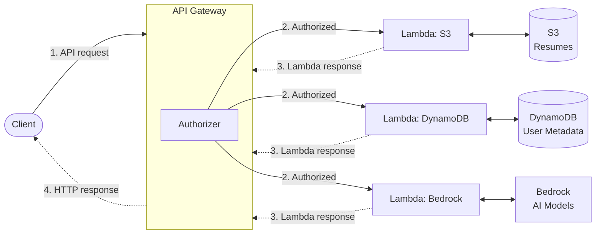

# Meeting Notes
This document will hold the notes from each of our meetings.

## Meeting 1
*Date: 10/13/2026*
### Agenda
1. Review (see below)
2. Code and Docs Tour (look through repo)
3. Attempted to set up local env (run `dev.py`)
### Architecture Review 
- Lambda: serverless compute
- DynamoDB: metadata
- S3: resumes
- Bedrock: AI access

### SAM Framework
- handle local testing
- handle deployment 
- Libraries: `boto3` (for accessing resources/services), `lambdaPowertools` (organize lambda functions)

### Local Dev Environment 
- SAM will set up a backend "server" to simulate lambdas
- Docker for local testing
- Docker container for DynamoDB and S3 (Bedrock is AI and can not be simulated)
- Everything runs in docker containers

*P.S. I made a file called dev.py and it sets up the local environment and runs one test. Run the python file and the docker containers + sam lambda simulation should be running. - Carter*

## Meeting 2
**Date: 10/15/2026**
### Endpoint Assignment
- Creating a user (post) - Tommy
- Editing a user (put) - Cooper
- Deleting a user - Santiago 
- Getting a user core metadata - Schneider
- Get user profile (get) - Carter

### HTTP Request Types
- Get: to get data
- Put: to place new rows
- Delete: to delete rows
- Patch: partial update 
- Put: full update